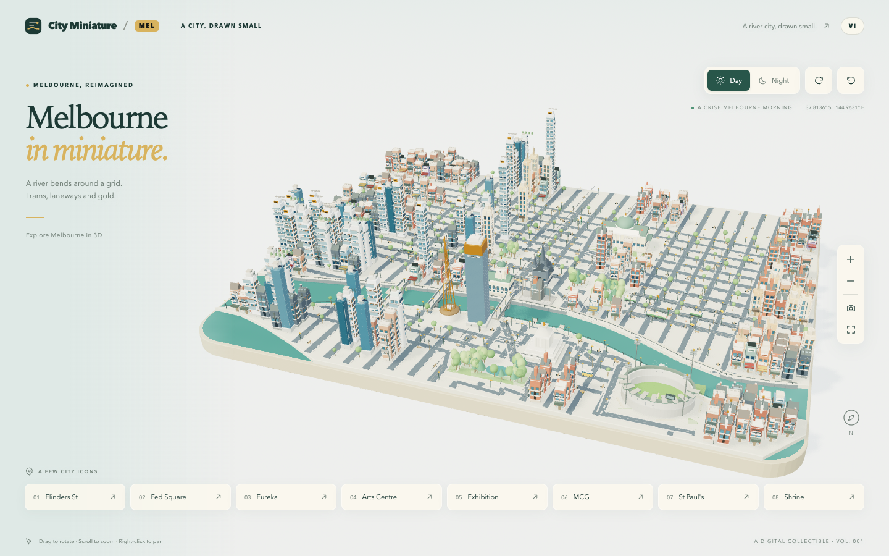
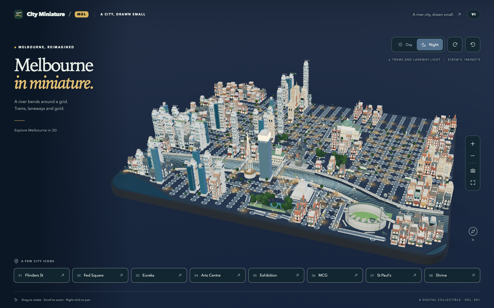

# Melbourne Miniature

**A river bends around a grid. Trams, laneways and gold.**

A from-scratch, offline Three.js diorama of central Melbourne. The Yarra separates the Hoddle Grid
from Southbank; eight landmarks, nine ordinary building families, three bridges, trams, river boats,
day/night lighting and an English/Vietnamese interface. The release is one self-contained HTML file
with no external assets or network calls.

It is an interpretive miniature, not a survey map, GIS viewer or navigation app.

| Day | Night |
| --- | --- |
|  |  |

Landmark flights: [Eureka Tower](docs/preview-eureka.png) · [Flinders Street Station](docs/preview-flinders.png)

## What is in it

- **Geography:** the Yarra channel and its two banks, the bay wedge at the south-west, Carlton
  Gardens, Fitzroy Gardens, Treasury Gardens, Flagstaff Gardens, the Royal Botanic Gardens and
  Yarra Park.
- **Eight landmarks:** Flinders Street Station, Federation Square, Eureka Tower, the Arts Centre
  Spire, the Royal Exhibition Building, the MCG, St Paul's Cathedral and the Shrine of Remembrance.
- **Nine ordinary families:** Victorian terrace, bluestone warehouse, glass office, Art Deco
  apartment, brick walk-up, laneway shop, riverside apartment, institution and hotel tower.
- **A connected plan:** the Hoddle Grid and its named streets, St Kilda Road, three river bridges
  and 291 building parcels.
- **City life:** seven trams on Swanston, Bourke, Collins, Flinders and St Kilda Road; cars, taxis,
  buses, vans and bikes; four boats on the river and bay; 44 pedestrians on the pavements.
- **Two climates, two languages:** day/night lighting and `en` / `vi` copy.
- **One file:** about 896 KiB, self-contained, no external requests.

## Run it

```sh
npm install
npm run dev          # Vite, http://localhost:5173
npm run typecheck
npm run test         # plan + geometry; no browser
npm run build:single # dist-single/index.html
```

## Verify it

```sh
npm run verify       # deterministic browser gate, 20/20 checks
npm run shot         # screenshots in shots/ (slow under SwiftShader)
```

`verify` serves the single file, drives `window.__scene` in capture mode and advances virtual time,
so the result does not depend on frame rate. It checks every landmark flight, day/night, reset,
zoom, orbit, pan, rotate, scene facts, both locales, the 345×345 embed, console errors and external
requests. Set `CHROME_PATH` if Chrome is not at the macOS default. `shot` is visual only; its
canvas captures are stable under SwiftShader, while full-page screenshots can time out after many
frames.

Current release: **2/2 test suites, 20/20 browser checks**, 1.1M triangles, 175 draw calls,
299 buildings.

## Publish it

The Pages-ready copy is `docs/index.html`; the screenshots are in `docs/`.

```sh
npm run build:single
cp dist-single/index.html docs/index.html
```

Then use **Settings → Pages → Deploy from a branch → main / docs**. Keep `docs/.nojekyll`.
The public copy, once published, is <https://somphol.github.io/melbourne-miniature/>.

The single file also runs from disk and inside the sandbox CSP: no images, fonts, fetches or
storage calls.

## Architecture

See [AGENTS.md](AGENTS.md) for the handoff, decisions and known issues.

```text
src/scene/geo.ts          river, banks, land polygons, districts, sites, bridges
src/scene/plan.ts         Hoddle Grid, named roads, connected graph, parcels
src/scene/kit.ts          instanced primitives and merged custom geometry
src/scene/buildings.ts    nine ordinary families and height rules
src/scene/landmarks.ts    eight landmark models and envelopes
src/scene/environment.ts  tray, water, roads, parks, walls, piers, trees, lamps, signals
src/scene/traffic.ts      trams, vehicles, boats and pedestrians
src/scene/scene.ts        renderer, camera, day/night, capture API
src/App.tsx               UI shell and controls
src/i18n/strings.json     English and Vietnamese copy
src/style.css             full, compact and embed layouts
tests/                    plan and geometry checks
scripts/                  notices, inline build, verify, screenshots
CITY.md                   the design contract
```

The construction order is deliberate: geography → plan → buildings/landmarks → environment →
traffic → scene → UI. Anything that needs the street network comes after the plan; anything that
needs final materials comes before the instanced kit is finished.

## Attribution

The scene is original Melbourne work. The mechanism follows the City Miniature skill and its San
Francisco reference, which derives from the Manhattan Miniature 0.2.0 sample by SandBase Lab. No
reference-city scene content, coordinates, models, strings or tests were copied. Details and
dependency licences are in [ATTRIBUTION.md](ATTRIBUTION.md).

## Rule

This project is not a template to reskin. If you build another city, author its geography, plan,
landmarks, transport, palette, copy and tests together for that city. A copied scene reads as the
old city with new labels.
